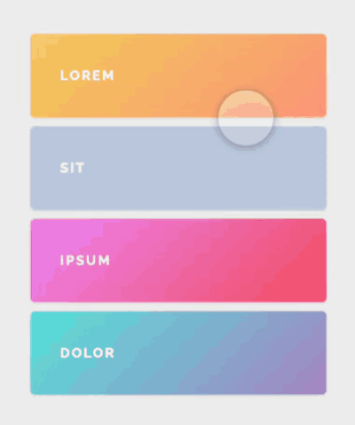

# Draggable List

A drag-to-reorder list built with [`@react-spring/web`](https://www.react-spring.dev/) and
[`@use-gesture/react`](https://use-gesture.netlify.app/). Grab a row, drag it, and the other rows
animate out of the way and settle into their new order.

<p align="center">
  
</p>

## Quick start

```bash
npm install
npm run dev
```

Then open the URL Vite prints (defaults to <http://localhost:5173>).

| Script | What it does |
| --- | --- |
| `npm run dev` | Start the Vite dev server with hot reload |
| `npm run build` | Typecheck (`tsc --noEmit`) then build to `dist/` |
| `npm run preview` | Serve the production build locally |
| `npm run typecheck` | Typecheck only |

## How it works

The whole thing is one component, [`src/App.tsx`](src/App.tsx), and the interesting part is what it
*doesn't* do: **dragging never triggers a React render.**

- **Order lives in a ref**, not in state. `order.current` is an array of indices describing which row
  sits in which slot. Mutating a ref doesn't re-render, so a drag that crosses three rows doesn't
  cause three React renders.
- **`useSprings` owns the animation.** Each row gets a spring controlling its `y`, `scale`, `zIndex`
  and shadow. On each gesture frame we call `api.start(...)` to feed the springs new targets, and
  react-spring writes directly to the DOM — bypassing React's render cycle entirely.
- **`useDrag` reports the gesture.** It gives us the row being dragged (via `args`), whether the
  pointer is still down (`active`), and how far it has moved (`movement`). From the drag distance we
  work out which slot the row is currently hovering over, and build a new order from that.
- **The dragged row is `immediate`.** Its `y` skips the spring and tracks the pointer exactly, so it
  feels pinned to the cursor, while every *other* row springs smoothly into its new slot.
- On release (`!active`) the provisional order is committed back into the ref.

`styleFor()` is the single source of truth for both states: it returns the "I'm being dragged" style
for the active row and the "I'm resting in slot N" style for everyone else.

### Things worth knowing

- **`touch-action: none`** on the rows (in `src/styles.css`) is required by `@use-gesture`. Without
  it, mobile browsers claim the vertical gesture for page scrolling and the drag never fires.
- **Row colours are bound to DOM position, not to the item.** The gradients come from
  `.content > div:nth-child(n)` and the DOM order never changes — only the transforms do. That's
  deliberate: the colours stay put while the labels move through them.
- **Rows are absolutely positioned** inside a container whose height is set to
  `items.length * ITEM_HEIGHT`, so the list reserves its full size up front and nothing reflows
  during a drag.

## Project structure

```
index.html        Vite entry point
src/
  main.tsx        Mounts the app with React 19's createRoot
  App.tsx         The draggable list
  styles.css      Layout, row gradients, custom cursor
  cursor.png      Custom drag cursor
docs/demo.gif     The animation above
```

## Stack

| | |
| --- | --- |
| React | 19 |
| Build tool | Vite 8 |
| Animation | `@react-spring/web` 10 |
| Gestures | `@use-gesture/react` 10 |
| Language | TypeScript 5 (strict) |

## Credits

Based on the classic [react-spring draggable list demo](https://www.react-spring.dev/), modernised
from its original React 16 / Create React App form.
